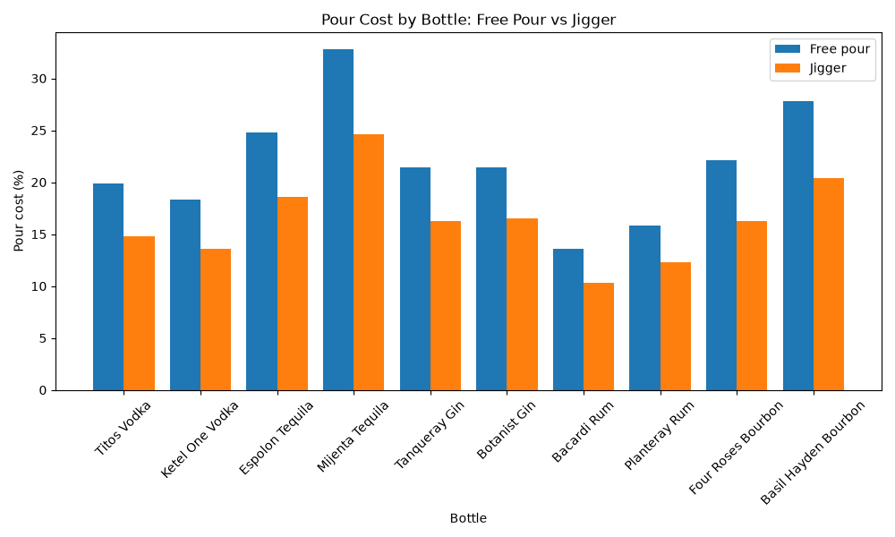
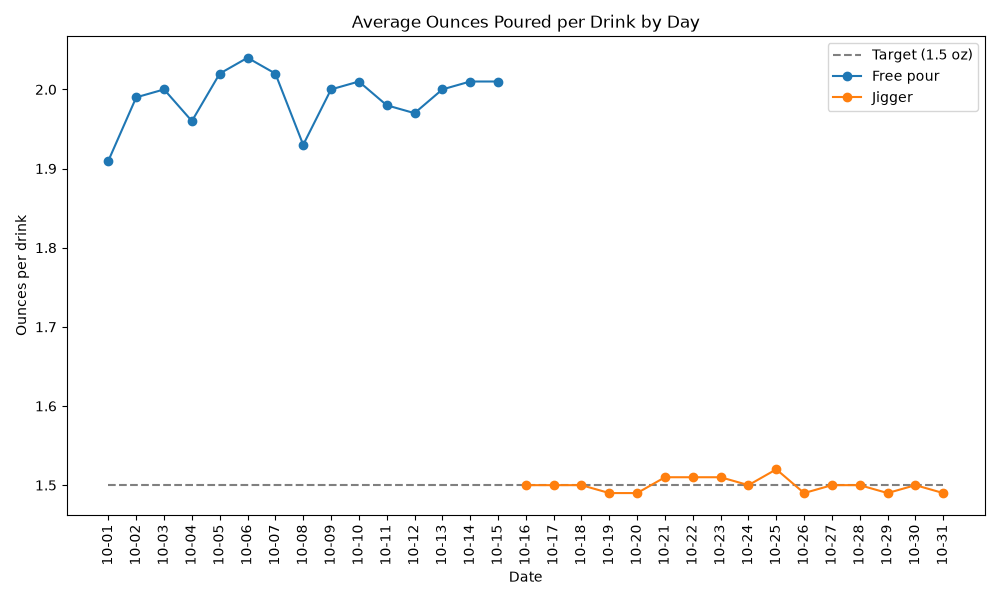

# Harper's Bar Pour Cost and Inventory Tracker

## Business Problem
Harper's Bar tracks liquor inventory and drink sales separately, so it is hard
to tell when bottles are being over-poured or when inventory goes missing. This
app keeps the bottle inventory and daily sales in one place so the manager can
compare how much liquor was used against how much was sold.

## Business Question
Which bottles are losing money to over-pouring, and does using a jigger
instead of a free pour lower our pour cost?

## How to Run
1. Open the project folder in VS Code
2. Run `main.py`
3. Choose an option from the menu

## Menu Options
1. View Inventory
2. Add or Restock a Bottle
3. Record a day's sale
4. Inventory Comparison - ounces used vs ounces sold for each bottle
5. Flag when inventory vs sales are different - lists days off by more than 10%
6. Pour cost report with charts - prints totals, best seller, and pour cost by bottle and pour type, then shows and saves 2 charts comparing free pour and jigger
7. Run 30-day simulation (coming soon)
8. Save and exit

## Files
- `main.py` - runs the menu
- `inventory.csv` - bottle cost, drink price, and ounces on hand for each bottle
- `sales.csv` - daily drink sales that have been recorded
- `inventory_counts.csv` - starting and ending ounces counted each day
- `pour_cost_by_bottle.png` - bar chart of pour cost for each bottle, free pour vs jigger
- `oz_per_drink_by_day.png` - line chart of the average ounces poured per drink each day

## Charts

Every bottle has a lower pour cost with a jigger, so the bar should keep using jiggers for all drinks.

Bartenders poured about 2 oz per drink with a free pour, but once jiggers started on Oct 16 every drink stayed close to the 1.5 oz target.

## Author
Karin Ferguson

